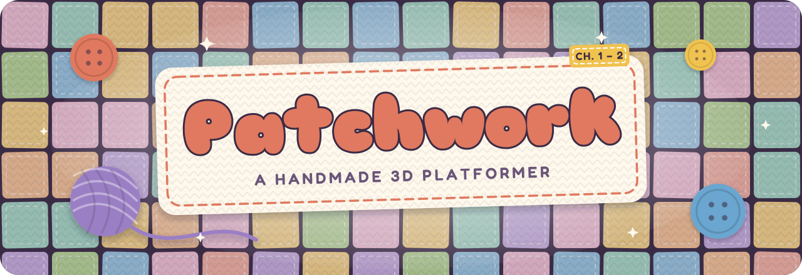
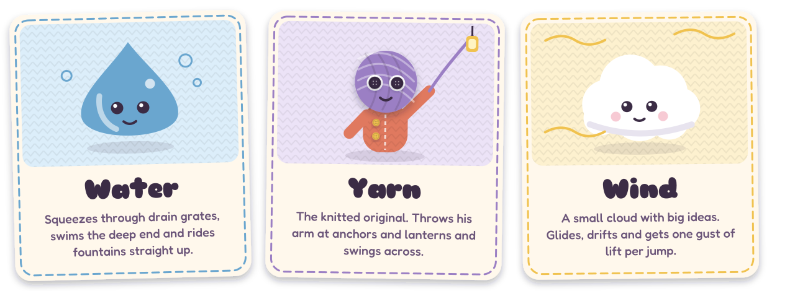
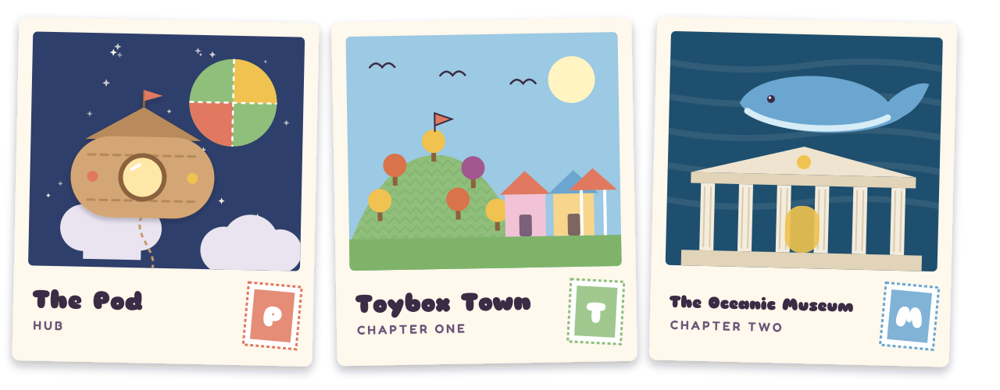
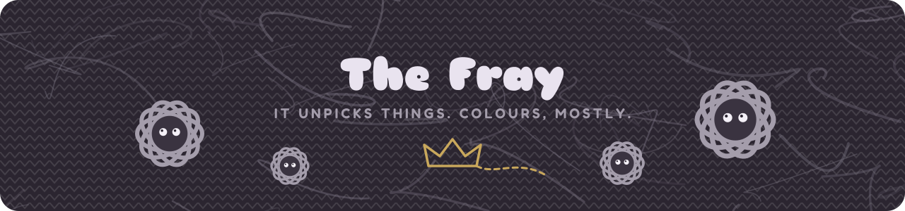

<p align="center">
  
</p>

<p align="center">
  <i>A small woollen hero, a world coming apart at the seams, and a great deal of thread.</i>
</p>

<p align="center">
  
  
  
  
  
</p>

<p align="center">
  <a href="#story"><b>Story</b></a> &nbsp;·&nbsp;
  <a href="#patch"><b>Patch</b></a> &nbsp;·&nbsp;
  <a href="#places"><b>Places</b></a> &nbsp;·&nbsp;
  <a href="#cast"><b>Cast</b></a> &nbsp;·&nbsp;
  <a href="#features"><b>Features</b></a> &nbsp;·&nbsp;
  <a href="#updates"><b>Updates</b></a>
</p>

<br>

<a name="story"></a>


> The world was sewn together a long time ago, and for the most part it has held.
>
> Lately, though, something has been pulling at the seams. Colours are draining out of things.
> A town band has lost its instruments on the morning of a wedding. A museum has mislaid an
> entire night.
>
> Someone ought to do something about it. As luck would have it, someone small, woollen and
> extremely determined has volunteered.

**Patchwork** is a 3D platformer in which the grass is knitted, the trees are pompoms, the sky is
cardboard and every cutscene is read aloud like a bedtime story. You play Patch, a toy who can
become water, yarn or wind, and the job is simple: go wherever the Fray has been, and mend it.

<br>

<a name="patch"></a>


<p align="center">
  
</p>

Patch can change at any moment, mid-jump included. Hold the **Form Wheel** and the world slows
down politely while he decides. Whatever he's wearing, whether dye, hat or entire outfit, comes
along for the ride in every form.

<br>

<a name="places"></a>


<p align="center">
  
</p>

<details open>
<summary><b>The Pod</b> &nbsp;<sub>HUB</sub></summary>
<br>

A cardboard pod drifting through a paper sky. Pick up the giant controller under the window and
turn the patchwork planet outside to choose where to go next. It's also home to:

- **The Store**, where your points become dyes, hats and outfits (it has its own song)
- **The Wardrobe**, for trying it all on, in every form
- **The Trophy Room**, for souvenirs, with a Merit cabinet that fills up as you go
</details>

<details>
<summary><b>Toybox Town</b> &nbsp;<sub>CHAPTER ONE · THE WEDDING THAT NEARLY WASN'T</sub></summary>
<br>

The Mayor is getting married today. The band, however, has been scattered across town by the
Fray, and a wedding without music is just a lot of people standing about in hats.

| Around town | Further out |
|---|---|
| Town Square and the Bandstand | **Spindle Hill**, sixteen metres of knitted hillside and its own autumn wood |
| The Clock Tower and Chimney Lane | The Whispering Wood and Moonglow Glade |
| The Dye Works and the Toy Workshop | Thread Ravine and the Tape-Measure Bridge |
| Inkwell Canal and the Duck Pond | Pom-Pom Grove and the Button Orchard |
| The Tea House and Picnic Park | Wildflower Meadow and Patchwork Farm |
| The Toy Barracks and the Toybox Express | The Wishing Willow and Toadstool Dell |

Also present: a xylophone bridge, a carousel, a domino run, a giant bubble wand that never stops blowing,
a bouncy castle, sky hoops, paper boats, and more things to poke than is strictly necessary.
</details>

<details>
<summary><b>The Oceanic Museum</b> &nbsp;<sub>CHAPTER TWO · THE NIGHT GLASS</sub></summary>
<br>

A grand museum after closing time. The visitors have gone home; the exhibits have not gone to
sleep. Help the night watchman put the Night Glass back together before morning, and try not to
let the Fray into the good rooms.

| The halls | The deep |
|---|---|
| The Forecourt and the Grand Atrium | The Kelp Galleries and the Coral Nursery |
| The Hall of Deep Time, and its Tyrannosaurus | The Deepsea Tunnel and the Lantern Deep |
| The Hall of Arms, and its Longship | The Sunken Ruins and the Drowned Temple |
| The Star Corridor and the Observatory | The Frozen Sea, the Mangrove and the Wreck |
| The Keepers' Room and the Undercroft | The Great Window and the Sea Gate |

On the itinerary: the Curator's Audit, a Museum Passport to stamp, five exhibits you're actually
allowed to touch, a whale who sings to herself every half minute, a Long Gallery best walked
through quickly, and five ghosts who are really just dust sheets with ambition.
</details>

<br>

<p align="center">
  
</p>

The Fray is a grey, tangling sort of nothing that drains the colour out of whatever it touches.
Its creatures are knotted together from loose ends: **Snarl Knots**, **Tangle Hoppers**, rollers,
and lantern lurkers waiting in the deep. They can be stomped, dashed through or given a firm
three-hit talking-to. Somewhere behind all of it is the **Unravelled King**: tall, needle-thin, and wearing a
thimble for a hat.

<br>

<a name="cast"></a>


| Who | What they're up to |
|:--|:--|
| **The Storyteller** | Reads the whole adventure aloud, page by page. Fully voiced, occasionally dry. |
| **The Mayor and his bride** | Due at the altar this afternoon. Waiting on a band. |
| **The town band** | Lute, trumpet, drum and Wisp the Piper. Currently in several places at once. |
| **Captain Buttonbeard** | A pirate camped at the top of Spindle Hill, for reasons he insists are nautical. |
| **Lady Lacewing** | Has lost every one of her presents, and remembers roughly where. |
| **Wick** | The museum's night watchman. Keys, stool, mug of tea. Has seen things. |
| **Professor Hoot & Professor Plume** | The museum's resident academics. One sets the homework, the other drops the hints. |

<br>

<a name="features"></a>


<table>
  <tr>
    <td width="50%" valign="top"><b>Storybook cutscenes</b><br><sub>A voiced narrator, a floating hand-held camera, soft focus on the close-ups, and stitched round wipes between scenes.</sub></td>
    <td width="50%" valign="top"><b>Proper climbing</b><br><sub>Stumps, ledges, pincushion bounce pads, lanterns to swing from, and giant buttons sewn into hillsides.</sub></td>
  </tr>
  <tr>
    <td valign="top"><b>Quests and secrets</b><br><sub>Side stories for the townsfolk, buried treasure, bubble trails, timed rushes, Heartstrings and threads to gather.</sub></td>
    <td valign="top"><b>Dress-up</b><br><sub>Dyes, hats and outfits from the Store, and three faces for Patch: happy, sad and cross.</sub></td>
  </tr>
  <tr>
    <td valign="top"><b>Photo Mode and stickers</b><br><sub>Pose him, frame it, and decorate the world while you're at it.</sub></td>
    <td valign="top"><b>Music that fills in</b><br><sub>Original songs for every place, which grow fuller as you put things right.</sub></td>
  </tr>
  <tr>
    <td valign="top"><b>Controller first</b><br><sub>Built around a PlayStation controller, with full keyboard and mouse support and prompts that follow whatever's in your hands.</sub></td>
    <td valign="top"><b>Three looks</b><br><sub>Storybook, Stitched or Plain, depending on how handmade you're feeling.</sub></td>
  </tr>
</table>

<br>

<a name="updates"></a>


| When | What changed |
|:--|:--|
| **Nov&nbsp;20,&nbsp;2026** | **Spindle Hill, rebuilt.** Sixteen metres of knitted hill, an autumn wood, and a climb to the top. |
| **Nov&nbsp;20,&nbsp;2026** | **Storybook cutscenes everywhere.** A hand-held camera, soft focus and stitched wipes between scenes. |
| **Nov&nbsp;20,&nbsp;2026** | **The Storyteller speaks.** Full narration for Toybox Town and the museum's opening. The villain gets a name. |
| **Nov&nbsp;19,&nbsp;2026** | **The Store opens properly,** with a shopfront and its own song, plus a new in-game controller menu. |
| **Nov&nbsp;17,&nbsp;2026** | **The Trophy Room** and its Merit cabinet, and a Wardrobe with real dyes and fitted outfits. |
| **Nov&nbsp;16,&nbsp;2026** | **Running and sprinting,** livelier combat, the Wardrobe, and the museum's opening story. |

<sub>The complete, dated history lives in the <a href="DEVELOPMENT_LOG.md"><b>Development Log</b></a>. What's done and what's next is in <a href="PROJECT_STATUS.md"><b>Project Status</b></a>.</sub>


<details>
<summary><b>Controls</b></summary>
<br>

| Action | PlayStation | Keyboard / Mouse |
|---|---|---|
| Move | Left stick | W A S D |
| Camera | Right stick | Mouse |
| Jump (hold as Wind to glide) | ✕ | Space |
| Run (keep holding to sprint) | L2 or L3 | Left Ctrl |
| Ability (Yarn swing, Wind gust) | ▢ | E |
| Strike (three in a row for a finisher) | ◯ | Left click or R |
| Grab (push, pull, levers) | R2 | Left Shift or right click |
| Quick change: Water / Yarn / Wind | D-pad ← / ↑ / → | 1 / 2 / 3 |
| Form Wheel | L1 (or R1) | Q |
| Stickers | △ | F |
| Patch's face | D-pad ↓ | 4 |
| Satchel | Touchpad | Tab |
| Map | R3 | M |
| Pause | Options | Esc |
</details>

<details>
<summary><b>For developers: running and building the project</b></summary>
<br>

**Requirements:** Unity **6000.6.7f1** (Unity 6) with the Universal Render Pipeline, on Windows.

1. Clone the repository and add the folder in Unity Hub (**Add → Add project from disk**).
2. Open it and let the first import finish.
3. Press **Play**. The game always starts in the Pod.

**Building:** choose **Patchwork → Build for Windows**. The game is written to
`Builds/Windows/Patchwork.exe`, and save data goes in the player's AppData folder.

**How it's made:** every level is built in code when its scene loads, so changes go in the level
builder scripts rather than the Scene view. The **Patchwork** menu in the editor opens each
scene, resets save data, replays story moments and runs the photo tours.

```
Assets/Patchwork/
├── Scripts/
│   ├── Core/      Game flow, saving, audio, music, lighting and level setup
│   ├── Forms/     Patch's three forms, models and effects
│   ├── Input/     Controller and keyboard input, haptics
│   ├── Player/    Movement, camera and the player controller
│   ├── UI/        HUD, menus, map, narrator and Photo Mode
│   └── World/     Level builders, characters, creatures, puzzles and props
├── Scenes/        Hub, Level1 and Level2
├── Resources/     Fonts, characters, narration and other runtime assets
├── Shaders/       Custom shaders
└── Editor/        Build tools and the Patchwork editor menu
```

Technical notes on how the systems fit together are in [`DEV_NOTES.md`](DEV_NOTES.md).
</details>


<p align="center">
  Created by <b>Anthony</b><br>
  <sub>Fonts: Fredoka and Sniglet, under the SIL Open Font License 1.1 (licences in <code>Assets/Patchwork/Resources/Fonts</code>).</sub><br>
  <sub>© 2026 Anthony. All rights reserved.</sub>
</p>
